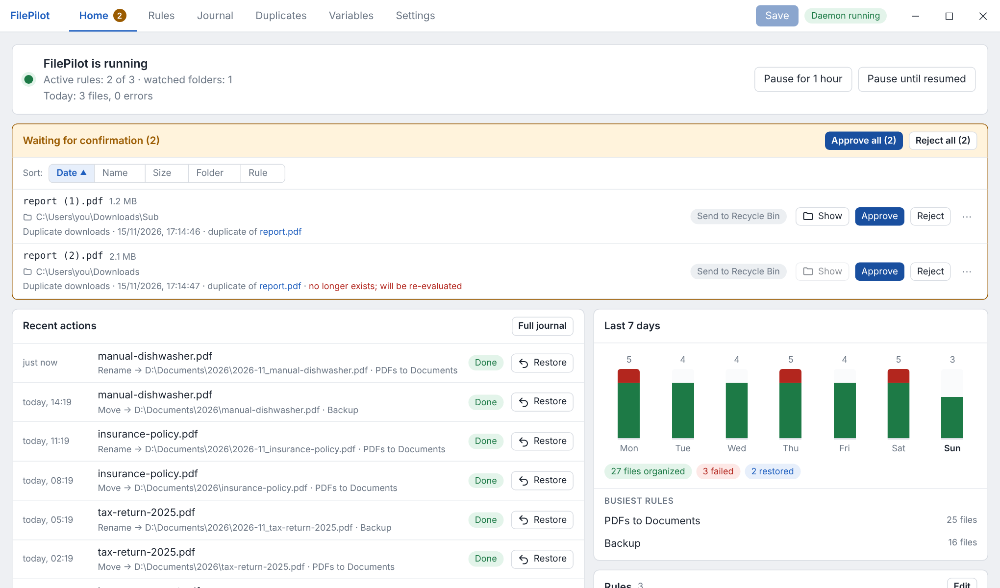

<div align="center">


# FilePilot

**Watches your folders and organizes files the moment they arrive.**
If-then rules for Windows: sort downloads, clean up duplicates, archive, back up. Every step can be undone.

[](LICENSE)
[](https://github.com/movidiu64/FilePilot/actions/workflows/windows.yml)
[](https://github.com/movidiu64/FilePilot/releases/latest)
[](https://github.com/movidiu64/FilePilot/releases/latest)

[](https://buymeacoffee.com/ovidiu64)



</div>

Pick the folders to watch, say which files you mean (*if*) and what should happen to them (*then*). A small background process with a tray icon reacts as soon as a file is created or changed, and sleeps the rest of the time. The window is only needed to edit rules and look at the journal.

## Features

- 📂 **Rules**: watch any folders (subfolders, network and removable drives included); nested *all of / any of* conditions on name, extension, path, size, dates and **file content** (text, DOCX, XLSX, ODT, PDF).
- ⚙️ **Actions**: move, copy, rename, change extension, **extract archives** (ZIP, RAR, 7z…), Recycle Bin, delete, run a program or a `cmd` command, **ask for confirmation**. Paths and names can use variables such as `{modified:AAAA}` or a dictionary (`{var:Supplier}`).
- 🧪 **Simulation**: a new rule can run "on paper" first; the journal shows what it would have done and nothing is touched.
- ↩️ **Undo**: every operation goes through a write-ahead journal and can be restored, even after a crash or from the Recycle Bin.
- 🧬 **Duplicates**: finds identical files (same folder or across folders), keeps the oldest copy, compares byte by byte before anything is removed. A fingerprint catalog keeps rescans of large folders fast.
- 🛡️ **Safe by design**: files still downloading or open in another program are left alone; found files are never opened with other programs or executed; Windows-reserved names are fixed before a move.
- 🔍 **Search**: find any file in your watched folders by name, extension, size or date, instantly after the first listing.
- 🏠 **Home page**: status, things that need attention, pending confirmations, recent actions and a 7-day chart. Pause from the tray icon for an hour or until you resume.
- 🪶 **Light**: written in Rust; with nothing to do it uses no CPU, and file content is read only when a rule needs it, once per file version.
- 🌐 English and Romanian interface, light and dark theme, rule templates and a first-run guide.

## Quick start

1. Download `FilePilot_<version>_x64-setup.exe` from [Releases](https://github.com/movidiu64/FilePilot/releases/latest). It installs per user, with no admin rights. A portable ZIP is also available.
2. Run it. Windows SmartScreen may warn about an unsigned app: choose **More info → Run anyway**.
3. On first start the guide asks which folder to watch (usually *Downloads*) and what to do with it, and shows how many files match right now. New rules start in simulation mode, so check the journal before you switch them on.

FilePilot needs Windows 10 or 11 (64-bit) and the WebView2 runtime, which the installer downloads if it is missing. Upgrading from *Organizator* (the earlier name) is automatic: rules, journal and autostart are carried over.

> [!TIP]
> Rules run from top to bottom and the first rule that moves a file wins. Put specific rules (invoices, duplicates) above the general sorting rule.

## Documentation

The [full guide](docs/guide.md) covers every condition and action, variables and date formats, duplicates, confirmations, the journal and restore, hidden rules, data files, the command line and how the project is built. The [changelog](CHANGELOG.md) lists what changed in each version.

## Development

Two Rust binaries share one data folder: `filepilot.exe` (crate `org-daemon`, background process and tray icon) and `filepilot-ui.exe` (crate `org-app`, a Tauri 2 window with plain HTML/CSS/JS, no Node build step). Requires Rust ≥ 1.89 and Visual Studio Build Tools (*Desktop development with C++*).

```powershell
cargo test --workspace --no-fail-fast    # unit, integration and crash-recovery tests
cargo build --release                    # target\release\filepilot.exe and filepilot-ui.exe
```

Building the installer locally:

```powershell
mkdir crates\app\binaries
copy target\release\filepilot.exe crates\app\binaries\filepilot-x86_64-pc-windows-msvc.exe
cd crates\app; npx @tauri-apps/cli@2 build --config tauri.bundle.json --bundles nsis
```

Every push runs the tests on Windows, builds the installer and tests it end to end (upgrade from the previous version, update with the daemon running, uninstall). A new version number on `main` publishes the release. See [Releasing](docs/guide.md#releasing).

## Support

FilePilot is free and has no ads or telemetry. If it saves you time, you can [buy me a coffee](https://buymeacoffee.com/ovidiu64) ☕. Bug reports and ideas in [Issues](https://github.com/movidiu64/FilePilot/issues) help just as much.

## Contributing

Issues and pull requests are welcome; please read [CONTRIBUTING.md](CONTRIBUTING.md) first, including the license terms for contributions.

## License

FilePilot is free software under the [GNU General Public License v3.0](LICENSE). You can use, study, modify and share it freely. If you distribute it, modified or not, you must make the source code available under the same license.

© 2026 Ovidiu ([movidiu64](https://github.com/movidiu64))
